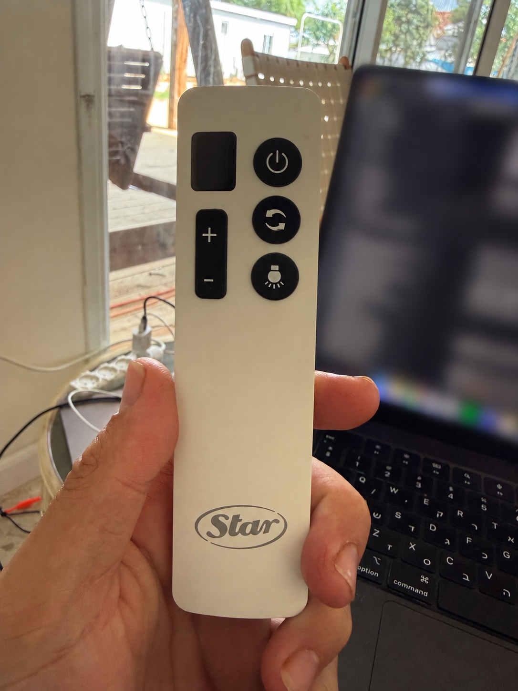
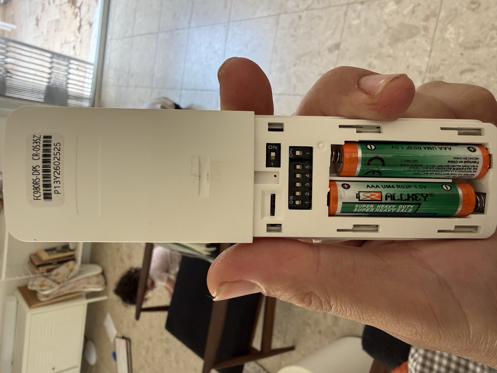

# Star Fan RF Control using CC1101
This is a simple repo containing code to send RF commands to Star (https://star.co.il/) fans using a basic CC1101 Transceiver ([python-cc1101](https://github.com/fphammerle/python-cc1101/tree/master)) wired to a Raspberry PI

| Remote | API address | Documentation |
| --- | --- | --- |
| Original Star 7 | Five-bit DIP-switch ID, 0–31 | [Original RF protocol](#rf-protocol) |
| FC980RS-DPS / CR-0535Z, display and +/− buttons | Captured three-byte prefix | [New remote setup](#fc980rs-dps-remote-support) |


## RF Protocol
The RF communication was recorded using [URH](https://github.com/jopohl/urh). Each remote got a few switches near the battery place that allows to change the remote "identifier", so several fans in proximity can be controlled by different remotes. 


Since I had two different remotes it was rather easy to parse the control packets -

 


- The remote baud rate is ~3300 (~300µs per symbol)
- Each bit got a carrier `10` bits - so `1101` is transmitted as `101101100101`
- The first 5 bits corresponds to the "identifier switches"
- The last 8 bits are the command
- Long-pressing a button just keeps transmitting the same packet repeatedly

### RF Commands Table

| Command | HEX |
| ------- | ---- |
| Power   | 0x84 |
| Light   | 0x82 |
| Speed 1 | 0x90 |
| Speed 2 | 0x94 |
| Speed 3 | 0xa0 |
| Speed 4 | 0xb0 |
| Speed 5 | 0xc4 |
| Speed 6 | 0xc0 |

## Using CC1101 to control the fan
After understanding the RF protocol we can use CC1101 (or any other RF transmitter/transceiver) to control the fans. See [control_fan.py](control_fan.py), the [protocol encoders](protocols), and the shared [radio sender](radio.py).

## Exposing API and wiring to Home Assistant
### Python Setup + Running Flask
```bash
sudo apt install python3.11
python -m venv /home/pi/python-env
source /home/pi/python-env/bin/activate
pip3 install -r requirements.txt
flask --app app run --host=0.0.0.0 # (or gunicorn -w 2 app:app)
```

### Flask and Gunicorn

A very simple flask application is included in [app.py](https://github.com/ngutman/star-fan-control/blob/master/app.py) which exposes `/control/<fan_id>/<command>`. 

A basic [.service](https://github.com/ngutman/star-fan-control/blob/master/fan-control.service) file is included to serve the app using Gunicorn.

### Home Assistant Fan Template
The original Star 7 example below uses the legacy template syntax. For the new
remote and current Home Assistant configuration, use the [modern template fan example](examples/homeassistant-fc980rs.yaml).

Once you have the service running on your raspberry pi you can use the following configuration to wire the API to a fan template (add to your configuration.yaml) - don't forget to correctly set `YOUR_RASPBERRY_PI_ADDRESS`

```yaml
rest_command:
  fan_control:
    url: "http://<YOUR_RASPBERRY_PI_ADDRESS>:5003/control/{{fan_id}}/{{command}}"
    method: GET
    content_type: "application/x-www-form-urlencoded; charset=utf-8"

# Keep track of the fan state
input_boolean:
  bedroom_fan_state:

# Keep track of fan speed
input_number:
  bedroom_fan_percentage:
    name: Bedroom Fan Percentage
    min: 0
    max: 100

fan:
  - platform: template
    fans:
      bedroom_fan:
        friendly_name: "Bedroom Fan"
        unique_id: bedroom_fan
        value_template: "{{ states('input_boolean.bedroom_fan_state') }}"
        percentage_template: >
          {{ states('input_number.bedroom_fan_percentage') }}
        turn_on:
          - service: rest_command.fan_control
            data:
              command: "speed3"
              fan_id: "28"
          - service: input_boolean.turn_on
            target:
              entity_id: input_boolean.bedroom_fan_state
          - service: input_number.set_value
            target:
              entity_id: input_number.bedroom_fan_percentage
            data:
              value: 50
        turn_off:
          - service: rest_command.fan_control
            data:
              command: "power"
              fan_id: "28"
          - service: input_number.set_value
            target:
              entity_id: input_number.bedroom_fan_percentage
            data:
              value: 0
          - service: input_boolean.turn_off
            target:
              entity_id: input_boolean.bedroom_fan_state
        set_percentage:
          - service: rest_command.fan_control
            data_template:
              command: >
                 speed1
                 speed2
                 speed3
                 speed4
                 speed5
                 speed6
                
              fan_id: "28"
          - service: input_number.set_value
            target:
              entity_id: input_number.bedroom_fan_percentage
            data:
              value: "{{ percentage }}"
        speed_count: 6
```

### If All Goes Well
You should have a fan entity, possibily exposed to HomeKit as well!


## FC980RS-DPS remote support

This remote has a speed display and +/− rocker instead of individual speed
buttons. The rear label reads **FC980RS-DPS / CR-0535Z**. The photos show the
remote used for the captures; matching appearance alone does not establish the
prefix for another fan.

 

The original `/control/<decimal-id>/<command>` routes remain compatible for
Star 7 fans (IDs 0–31). A second route supports the captured FC980RS-DPS variant:

```text
GET /control/fc980rs/<six-hex-digit-prefix>/speed1
GET /control/fc980rs/<six-hex-digit-prefix>/speed6
GET /control/fc980rs/<six-hex-digit-prefix>/on
GET /control/fc980rs/<six-hex-digit-prefix>/off
GET /control/fc980rs/<six-hex-digit-prefix>/light_toggle
```

Use your captured three-byte prefix, not the old five-bit DIP-switch ID. See
[protocol evidence and remaining hardware checks](docs/protocol-fc980rs.md).
The light supports a captured toggle command; reverse is not yet supported. Successful new requests
return `{"status":"transmitted", ...}`: this confirms transmission completion,
not reception by the fan. Invalid commands/addresses return HTTP 400; radio
contention or failure returns 503. Existing valid routes retain their response.

All workers serialize complete bursts via `FAN_RADIO_LOCK` (default
`/tmp/star-fan-control.lock`). Keep one shared path for every process controlling
this radio. The service's `PrivateTmp=true` shares that location among its workers,
but manual scripts outside the service must stop the service before using SPI.
`GET /health` tests HTTP liveness without touching the radio. This API is intended
for a trusted LAN and has no authentication; do not expose it publicly.

### Home Assistant

Use the modern [Living Room Fan example](examples/homeassistant-fc980rs.yaml).
Merge its sections into existing configuration, substitute the captured prefix
and Pi address, validate, and reload REST commands/helpers/templates. Zero percent
sends off; positive percentages select one of six speeds. Turning on selects the
stored speed or speed 1. Helpers update only after a successful REST action, but
remain optimistic: the remote and fan send no acknowledgment to this API.

The example also adds **Living Room Fan Light**. Its on/off actions share a
queued script that sends `light_toggle` only when the tracked state must change.
Repeated on or off requests therefore do not toggle twice. Merge the script
entry into `scripts.yaml` if your configuration uses `script: !include scripts.yaml`,
and reload scripts as well. Initially set `input_boolean.living_room_fan_light_state`
to the actual light state. Using the physical remote, a missed RF transmission,
or a receiver power cycle can make this state inaccurate; correct that helper
before controlling the light again. Updating the helper itself sends no RF.

### Development and deployment

Python 3.11+; production requirements remain in `requirements.txt`. Pure encoder,
API, and simulated radio tests do not require SPI or the CC1101 package:

```sh
python -m pip install -r requirements-dev.txt
python -m unittest discover -s tests -v
```

Before deployment, back up the checkout and systemd unit. Stop `fan-server`,
install the tested revision using the existing virtual environment, and start it.
Check `/health` and invalid-input handling before controlled physical tests. Roll
back by stopping the service and restoring its previous checkout/unit. Home
Assistant configuration must be backed up and validated separately.
